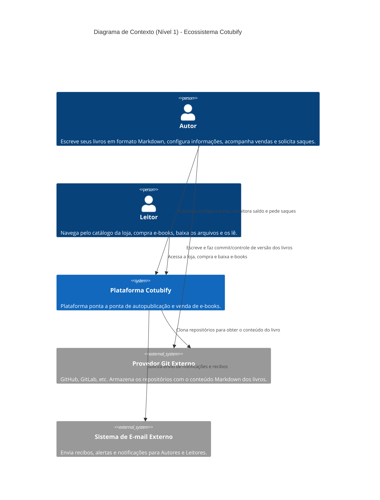
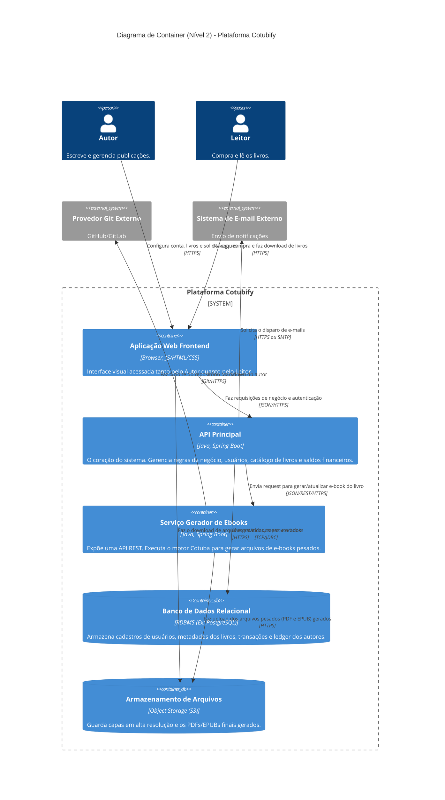

# Arquitetura Cotubify

O Cotubify é uma plataforma ponta a ponta de autopublicação e venda de e-books. O sistema conecta autores, que escrevem seus livros usando Markdown e os versionam via Git, a leitores que podem navegar pelo catálogo, comprar e baixar as obras automaticamente convertidas para PDF e EPUB.

## Diagrama de Contexto

## Diagrama de Container

